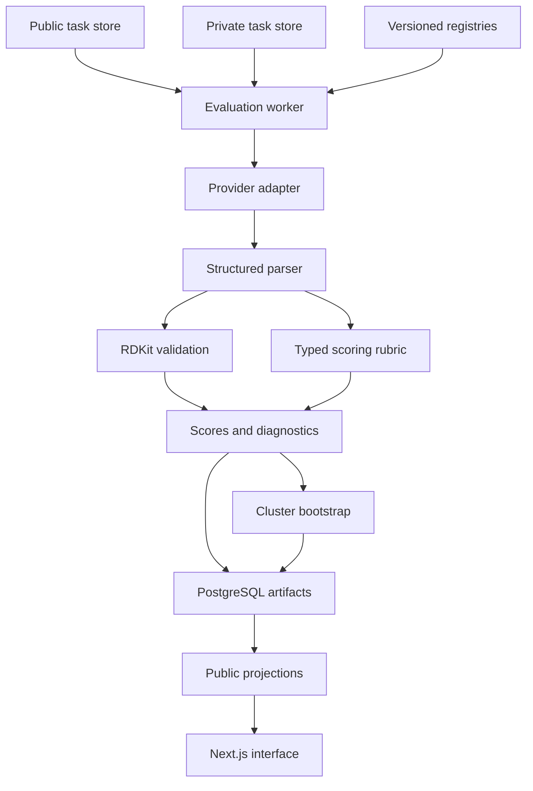

# Architecture and implementation plan — v0.1.0

## Existing state and assumptions
The supplied workspace contained only the product brief, with no repository or credentials. This is a new monorepo. Python 3.11+ and Node 22+ are supported. PostgreSQL is the deployment database; SQLite is an explicit local/test option. No paid API, private dataset, public deployment, or external account is assumed. The release is a research infrastructure preview, not a scientifically validated ranking organization.

## Boundaries
- `chemagent/benchmarks`: strict versioned task schemas, provenance and duplicate checks, public/private stores.
- `chemagent/providers`: public requests only; providers never receive reference answers. Deterministic mock solver plus explicit unsupported adapter contracts.
- `chemagent/chemistry`: RDKit descriptors, structures, fingerprints and structured validation errors.
- `chemagent/scoring`: field rubrics, severity-weighted reliability proxy, immutable scoring policy.
- `chemagent/statistics`: category-stratified cluster bootstrap, intervals and paired comparisons.
- `chemagent/evaluation`: execution, bounded retry, checkpointing, audit artifacts, fingerprints.
- `chemagent/database`: typed SQLAlchemy records and transaction boundaries. Alembic owns schema changes.
- `backend/app`: read API, health checks and safe, disabled-by-default submission intake.
- `frontend`: Next.js server-rendered pages with interactive filtering and comparisons; no embedded score fixtures.
- `benchmarks`, `configs`: versioned scientific inputs, configuration and fingerprints.

The first implementation is a modular monolith. Evaluation workers are launched by CLI, not public HTTP requests. This keeps private benchmark material and provider credentials outside the public web process. Future workers can consume a queue without changing scorer/provider interfaces.

## Ordered phases
1. Design: architecture, SQL schema, benchmark schema and scoring policy.
2. Core: 60 authored synthetic tasks, independent mock solver, RDKit, scoring, statistics; test each boundary.
3. Storage: PostgreSQL-compatible migrations, append-only finished runs and snapshots, resumable failures, CLI and REST API; exercise migrations and API.
4. Web: homepage, rankings, profile/task inspection, benchmark explorer, methodology, comparison and submission status; typecheck and production build.
5. Delivery: Docker Compose, CI, governance, scientific limitations, runbook and release evidence; package a clean repository archive.

## Coverage and non-goals
The starter six-category profile is explicitly different from the full nine-category vision. No spectroscopy competency, synthesis feasibility, drug potency, clinical safety, citation truth on the live internet, or expert validation is inferred from simple fixtures. Human review, federated providers, accounts/RBAC, expert adjudication, arena voting, billing and enterprise isolation are separate planned phases. Schema reservations do not imply working products.

## Data flow
Task store → public request → adapter → captured response → strict JSON parser → typed rubric and RDKit validation → task score → stratified statistics → transactional checkpoint → immutable result → public read model.

## Integrity and security
Run identity records benchmark bytes, scoring policy, configuration, dependency versions, adapter/model version, tool permissions and git revision. Resume rejects changed inputs. Failed/incomplete runs never enter rankings. Hidden data is read only from an operator-configured directory outside the repository and is not served by API. Mock providers cannot run against hidden sets. No arbitrary code execution, URL fetches, user-controlled provider endpoints, or uploads are exposed in the public API.

## Component relationships

Private reference answers stay in the trusted worker boundary. The provider receives only public requests. Private task bodies and responses are excluded from public projections. This diagram describes component boundaries, not a claim that all planned commercial providers are implemented.
